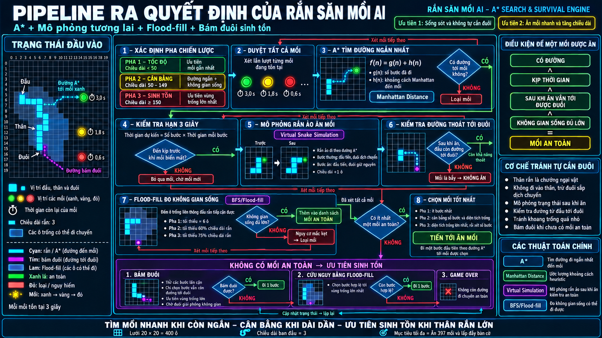

# Snake AI — A* Search & Survival Engine

An autonomous Snake game built with Python and Pygame. The agent combines A* pathfinding, virtual future-state simulation, BFS/Flood-Fill space analysis, and tail-chasing heuristics to collect food without trapping itself.



## Highlights

- A* shortest-path search with Manhattan distance.
- Dynamic food that expires after three seconds.
- Virtual snake simulation before committing to food.
- Head-to-tail reachability checks after simulated growth.
- BFS/Flood-Fill analysis of the remaining safe space.
- Three adaptive strategies based on snake length.
- Tail chasing and maximum-space fallback behavior.
- Interactive Pygame dashboard with path visualization and speed controls.

## Decision pipeline

A food item is accepted only when all four conditions are satisfied:

```text
Path exists
AND the snake can arrive before expiration
AND the head can still reach the tail after eating
AND the remaining reachable space is large enough
```

The strategy changes as the snake grows:

| Phase | Snake length | Main priority |
|---|---:|---|
| Phase 1 | `< 50` | Shortest path and speed |
| Phase 2 | `50–149` | Balance path length and free space |
| Phase 3 | `≥ 150` | Maximum reachable space and survival |

When no food is safe, the snake first follows its tail to buy time. If that is unavailable, it chooses the neighboring move with the largest Flood-Fill region. The game ends only when no valid move remains.

## Project structure

```text
MiniProject_Snake_A_Star/
├── docs/
│   └── images/
│       └── pipeline.png       # Decision-pipeline infographic
├── snake_ai/
│   ├── __init__.py            # Public package interface
│   ├── config.py              # Board, rules, speed, and colors
│   ├── game.py                # Pygame loop, input, and rendering
│   ├── models.py              # Snake, food, and food manager
│   └── solver.py              # A*, simulation, Flood-Fill, survival AI
├── tests/
│   └── test_solver.py         # Core algorithm checks
├── .gitignore
├── main.py                    # Recommended entry point
├── requirements.txt
└── Snake_A_star.py            # Backward-compatible launcher
```

## Requirements

- Python 3.10 or newer
- Pygame 2.5 or newer

## Installation

```bash
git clone <your-repository-url>
cd MiniProject_Snake_A_Star
python -m venv .venv
```

Activate the virtual environment:

```bash
# Windows PowerShell
.venv\Scripts\Activate.ps1

# macOS/Linux
source .venv/bin/activate
```

Install the dependency:

```bash
python -m pip install -r requirements.txt
```

## Run

```bash
python main.py
```

The legacy command remains supported:

```bash
python Snake_A_star.py
```

## Controls

| Key | Action |
|---|---|
| `Space` | Pause or continue |
| `R` | Start a new game |
| `P` | Show or hide the planned path |
| `1`–`4` | Select a speed preset |
| `Left` / `Right` | Cycle through speed presets |

## Run tests

```bash
python -m unittest discover -s tests -v
```

## Goal

The board contains `20 × 20 = 400` cells. Starting at length 3, the theoretical target is to eat 397 food items and fill the entire board without colliding with the wall or the snake's body.

## Algorithm note

The survival policy is heuristic rather than a formal guarantee of reaching 400 cells. The solver reevaluates the board after every move, which lets it react to expiring food and the constantly changing snake body.
